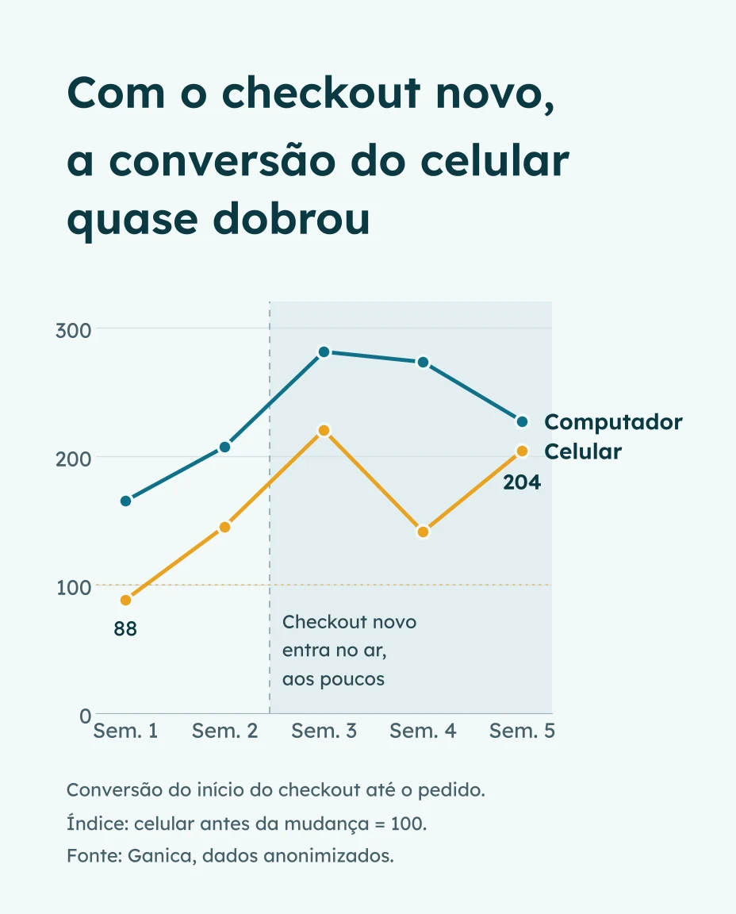
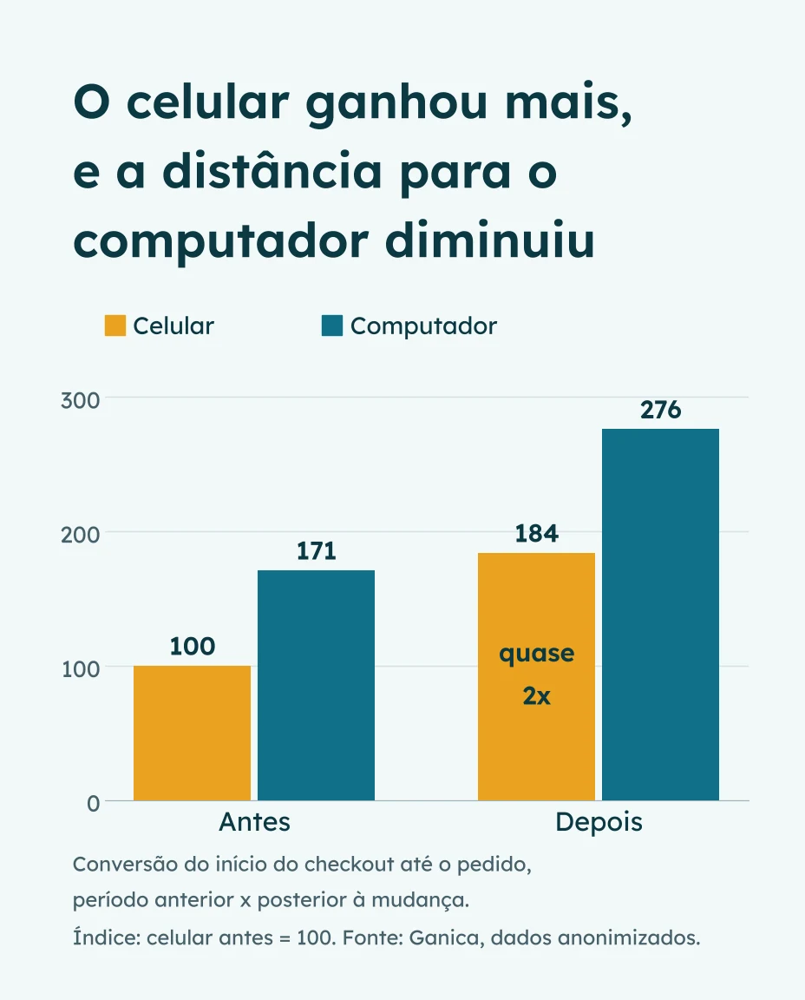

## O problema: o celular chegava ao checkout, mas não comprava

O ponto de partida foi uma reclamação comum: "o celular converte mal". A reação natural é redesenhar o site mobile inteiro. Antes disso, a pergunta que importa é outra: **em qual etapa o celular perde?**

Neste e-commerce brasileiro, a resposta veio do funil aberto por etapa e por dispositivo. Funil é a sequência de passos até a compra: ver o produto, colocar no carrinho, iniciar o checkout e concluir o pedido. O celular acompanhava o computador até a entrada no checkout, e em alguns pontos até ia melhor. A distância aparecia só no último passo.

| Etapa | Celular x computador |
|---|---|
| Ver produto e colocar no carrinho | Empate ou celular à frente |
| Do carrinho até iniciar o checkout | Empate ou celular à frente |
| Do início do checkout até o pedido | Computador muito à frente |

*Leitura do funil por dispositivo antes da mudança. Fonte: análise da Ganica, dados anonimizados.*

No celular, só **cerca de 1 em cada 5** pessoas que iniciavam o checkout concluíam o pedido. Esse recorte descartou de saída várias explicações. Se o problema fosse tráfego ruim, preço ou frete, ele apareceria em várias etapas, não só no fim. Uma perda localizada aponta para a mecânica daquele passo. (O método de leitura do funil por dispositivo está detalhado no estudo [Por que o celular converte menos?](/conversao-checkout-mobile-funil-por-dispositivo.html))

## O que foi encontrado: três atritos no último passo

O funil mostra **onde** a venda se perde. Para entender **por quê**, a análise passou para o comportamento: gravações de sessão (vídeos anônimos da navegação) e mapas de calor (onde as pessoas tocam e rolam a tela). Três atritos apareceram, todos no mesmo lugar.

**1. A verificação de identidade tirava o cliente da loja.** Depois de preencher os dados de pagamento e tocar em comprar, o cliente precisava confirmar a identidade com um código recebido fora do site. No celular, isso significa trocar de aplicativo, procurar a mensagem, copiar o código e voltar. Cada troca é uma chance de não voltar.

**2. Havia uma segunda confirmação logo depois.** Na volta, o cliente ainda passava por outra checagem de segurança e precisava tocar de novo no botão de compra. As gravações mostravam a dúvida: a verificação já tinha valido? O pedido tinha sido feito ou não?

**3. O botão final não conversava com o texto ao redor.** Em uma das formas de pagamento, a orientação na tela mandava tocar num botão com um nome, mas o botão real tinha outro nome e ficava em outro lugar. Parte das pessoas tocava na área de texto tentando concluir.

> Nenhum dos três problemas era visível na taxa de conversão geral. Todos estavam no passo com mais intenção de compra da loja inteira.

Esses atritos não são raros. Nas pesquisas da Baymard Institute com compradores online dos Estados Unidos, checkout longo ou complicado e a exigência de criar conta aparecem entre os motivos declarados para desistir da compra.

O ponto em comum chama atenção: o cliente que chegava até ali já tinha escolhido o produto, aceitado o frete e digitado os dados de pagamento. A loja perdia justamente quem já tinha decidido comprar.

## A decisão: um checkout novo, com o valor estimado antes

Antes de propor a solução, a Ganica estimou **quanto a perda custava**. A conta partiu da distância entre a conversão do celular e a do computador no checkout, em dois cenários: o celular fechando metade dessa distância, ou alcançando o computador. Os dois cenários colocaram a correção do checkout como a ação de maior retorno entre todas as levantadas no diagnóstico.

Essa estimativa mudou a conversa com o cliente. Em vez de "o checkout tem problemas de experiência", a pauta passou a ser "este passo custa este tanto por trimestre". Com o valor na mesa, a prioridade da tecnologia deixou de ser uma disputa de opinião.

A primeira recomendação era corrigir cada atrito: levar a identificação do cliente para antes do checkout, retirar a confirmação duplicada e refazer o botão final. Como os três estavam encadeados e o checkout era personalizado, corrigir um sem mexer nos outros era difícil. A decisão do cliente foi **trocar o checkout inteiro** por uma versão nova, sem a saída da loja no último passo.

O diagnóstico e a recomendação foram da Ganica. A implementação foi do time de tecnologia do cliente.

## Como a mudança entrou no ar sem arriscar as vendas

Trocar o checkout é mexer no ponto mais sensível de uma loja: é ali que o dinheiro entra. Por isso a mudança **não foi ligada para todo mundo de uma vez**.

1. **Primeiro, uma parte pequena do tráfego.** O checkout novo começou com uma fatia pequena dos clientes. O objetivo dessa fase não era medir ganho, era garantir que nada quebrava: pedidos chegando, pagamentos aprovados, nenhum erro novo.
2. **Depois, metade.** Com a primeira fase estável, a versão nova passou a atender metade do tráfego. Com volume maior, os números começaram a ter peso.
3. **Ampliação conforme a confirmação.** A versão nova foi ampliada à medida que os resultados se mantinham.

Essa sequência protege a receita. Se o checkout novo tivesse um defeito, ele atingiria poucos clientes por pouco tempo, e voltar atrás seria imediato.

## O resultado: perto de 2 em cada 5

Comparando o período anterior à mudança com o período posterior, a proporção de pessoas que iniciaram o checkout no celular e concluíram o pedido saiu de **cerca de 1 em cada 5** para **perto de 2 em cada 5**. É quase o dobro.

O gráfico usa um índice para não expor números do cliente: a conversão do celular antes da mudança vale 100, e todo o resto é medido em relação a ela. Um valor de 200 significa o dobro da proporção de antes.

Duas coisas aparecem na evolução. A primeira é a virada: ela começa na semana em que o checkout novo entra no ar e se firma nas semanas seguintes. A segunda é a oscilação. Houve uma semana mais fraca no meio do caminho, e isso é normal quando o número de pedidos por semana é pequeno. Por isso a conclusão se apoia no período inteiro, não numa semana boa.

Três leituras ajudam a entender o tamanho disso:

- **Não é ruído.** Com o volume de pessoas no checkout nos dois períodos, uma diferença desse tamanho tem chance muito pequena de ser variação normal (teste de duas proporções, confiança acima de 99%).
- **Não é medição duplicada.** Antes de comemorar, os registros de compra foram conferidos: nenhum pedido contado duas vezes e nenhum registro sem identificador.
- **Não veio de mais tráfego.** A conta é feita sobre quem já iniciou o checkout, então mais visitas não explicam o ganho. O que subiu foi a proporção dessas pessoas que conclui o pedido.

O computador também melhorou depois da mudança, o que é esperado: ele usa o mesmo checkout. O celular, que perdia mais, foi quem mais ganhou, e a distância entre os dois diminuiu.

No financeiro, o ritmo de pedidos a mais observado nas primeiras semanas ficou **perto do teto** da projeção feita antes da mudança.

## O que ainda não sabemos

Este é um caso, não uma regra. Os limites precisam estar claros:

- **É antes e depois, não um teste lado a lado.** As duas versões rodaram juntas por um tempo, mas a ferramenta de análise não registrava qual versão cada pessoa viu. Por isso a comparação é entre períodos, e qualquer outra coisa que tenha mudado entre eles (campanhas, época do ano, mix de produtos) pode ter pesado no resultado.
- **O período ainda é curto.** São semanas de dado, não meses. O número pode se acomodar para um pouco abaixo do que aparece agora.
- **O checkout novo mudou mais de uma coisa.** Como os três atritos foram resolvidos juntos, não dá para dizer quanto do ganho veio de cada um.
- **Funciona para quem tem o mesmo tipo de perda.** Se a sua loja perde venda no início do funil, e não no checkout, trocar o checkout não resolve.

## O que levar para a sua loja

O resultado não veio de uma ideia criativa. Veio de uma sequência que qualquer operação pode repetir:

1. **Abra o funil por etapa e dispositivo** e encontre o passo onde a distância aparece.
2. **Confira a medição** antes de qualquer conclusão: um evento de compra que falha parece uma queda de conversão.
3. **Assista o comportamento** naquele passo específico, com gravações e mapas de calor, para chegar à causa provável.
4. **Coloque um valor na perda** antes de propor a solução. É isso que faz a correção virar prioridade.
5. **Libere a mudança aos poucos** e registre qual versão cada cliente vê, para comparar as duas no mesmo período.
6. **Meça em pedidos e receita**, não em cliques.

Se você quer saber em qual passo a sua loja perde a venda e quanto isso vale, esse é exatamente o ponto de partida do [diagnóstico de conversão](/#diagnostico).
