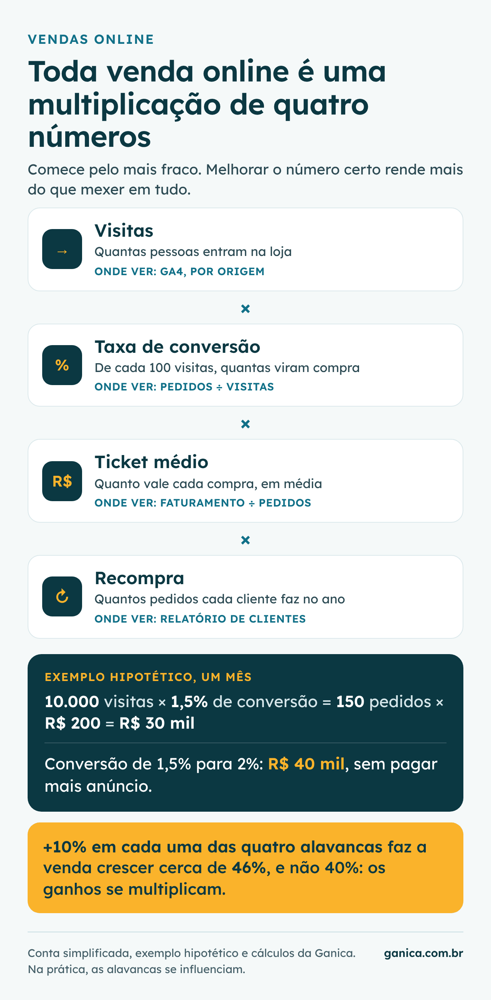

## Como aumentar as vendas online?

Para aumentar vendas online, descubra primeiro qual parte da sua loja está fraca e comece por ela. Toda venda pela internet depende de quatro números: quantas pessoas visitam a loja, quantas delas compram, quanto cada uma gasta e quantas voltam a comprar. Se um desses números está baixo, nenhuma dica genérica resolve até ele melhorar.

A Ganica leu as dez páginas que a Visão geral da IA do Google cita para essa pergunta. Quase todas trazem listas de 7 a 25 dicas, e só uma sugere por onde começar. Também é comum usar números de outros países ou sem fonte. Este guia propõe outra ordem: primeiro a conta, depois o diagnóstico com números e, por fim, o que fazer em cada caso.

## Quais são as quatro alavancas das vendas online?

As quatro alavancas são visitas, taxa de conversão, ticket médio e recompra, e a venda é a multiplicação delas. Alavanca, aqui, é um número que, quando sobe, puxa a venda junto. Numa conta simplificada do ano: as visitas que viram compra formam os clientes, cada cliente faz um certo número de pedidos (a recompra) e cada pedido vale o ticket médio.

| Alavanca | O que significa, em palavras simples |
|---|---|
| Visitas | Quantas pessoas entram na loja |
| Taxa de conversão | De cada 100 visitas, quantas viram compra |
| Ticket médio | Quanto cada compra vale, em média |
| Recompra | Quantos pedidos cada cliente faz no ano |

*Leitura da Ganica.*

Um exemplo hipotético ajuda. Uma loja com 10 mil visitas no mês, que converte 1,5% delas, tem 150 pedidos. Com ticket médio de R$ 200, vende R$ 30 mil. Se a conversão subir para 2%, a mesma loja passa a vender R$ 40 mil, sem gastar nada a mais com anúncio.

Como os números se multiplicam, pequenas melhorias somadas viram uma grande. Num exemplo simples da Ganica, melhorar 10% em cada uma das quatro alavancas faz a venda crescer cerca de 46%, e não 40%, porque cada ganho multiplica o anterior. Na vida real as alavancas se influenciam, então o número serve para mostrar a ideia, não como previsão.

O cliente online brasileiro já compra mais de uma vez. Segundo a [Abiacom](https://mundodomarketing.com.br/e-commerce-brasileiro-cresce-15-3-e-fatura-r-235-5-bilhoes-em-2025), o e-commerce teve 438,9 milhões de pedidos e 94,2 milhões de compradores em 2025, com ticket médio de R$ 536,60. Pela conta da Ganica, são cerca de 4,7 pedidos por comprador no ano. A recompra existe; a pergunta é se ela acontece na sua loja ou na do concorrente.

## Por onde começar para vender mais?

Comece pela alavanca mais fraca, e descubra qual é antes de gastar com qualquer ação. Os números estão no Google Analytics 4 (GA4), a ferramenta gratuita do Google que mede o que acontece no site, e no painel da sua plataforma de loja.

1. **Anote as visitas do mês** no GA4, em Relatórios, Aquisição, Aquisição de tráfego. Ali elas aparecem separadas por origem: busca gratuita do Google, anúncios, redes sociais, e-mail e acesso direto (quem digitou o endereço da loja).
2. **Calcule a taxa de conversão:** pedidos divididos por visitas, vezes 100. Faça a conta separada para celular e computador.
3. **Calcule o ticket médio:** faturamento dividido pelo número de pedidos.
4. **Veja a recompra:** dos clientes que compraram há um ano, quantos compraram de novo? A maioria das plataformas mostra isso no relatório de clientes.
5. **Compare cada número com o mesmo mês do ano passado.** O que caiu, ou o que nunca subiu, é por onde começar.

| Sinal nos seus números | Alavanca fraca |
|---|---|
| Visitas menores que no mesmo mês do ano passado | Visitas |
| Conversão no celular bem abaixo da do computador | Taxa de conversão |
| Ticket médio parado ou caindo | Ticket médio |
| Poucos clientes de um ano atrás compraram de novo | Recompra |

*Leitura da Ganica.*

Há um erro comum nessa ordem. É um padrão que encontramos com frequência em diagnósticos: marcas que cresceram pela busca gratuita do Google e por acesso direto decidem comprar anúncios e pagam para levar visitantes a páginas que ainda não convertem bem. A ordem certa é corrigir os problemas óbvios do caminho de compra e só então aumentar a verba.

## Como atrair mais visitantes que compram?

Atrair mais visitantes só ajuda quando eles chegam com vontade de comprar o que você vende. Mil visitas de quem procura "presente para pai que gosta de café" valem mais do que dez mil de quem viu um vídeo engraçado e saiu.

- **Busca do Google (SEO):** SEO é o trabalho de fazer a loja aparecer de graça na busca. Comece pelas páginas de categoria e de produto, com nomes que as pessoas realmente digitam e descrições que respondem às dúvidas de quem vai comprar.
- **Anúncios:** anúncios no Google e nas redes trazem visitas rápido, mas cada clique custa. Comece pelas buscas com intenção clara, como o nome do produto, e meça o custo de cada venda, não só o de cada clique.
- **Marketplaces:** os marketplaces já têm gente procurando produtos, então funcionam como vitrine extra. Em troca, cobram comissão e ficam com o contato do cliente.
- **Conteúdo e redes sociais:** mostrar o produto em uso e responder dúvidas reais ajuda a ser lembrado. É um caminho mais lento, que soma com o tempo.
- **Datas comemorativas:** Black Friday, Natal e Dia das Mães concentram procura. Prepare com antecedência, como mostra o [guia de Natal e Ano Novo](/como-vender-mais-natal-ano-novo-ecommerce.html).

## Como fazer mais visitantes comprarem?

Mais visitantes compram quando a loja tira as dúvidas e os obstáculos do caminho, e o primeiro lugar para olhar é o celular. Segundo a [TIC Domicílios 2025](https://cetic.br/media/analises/tic_domicilios_2025_principais_resultados.pdf), do Cetic.br, 65% dos usuários de internet no Brasil acessavam a rede só pelo celular em 2025. Faça você mesmo uma compra completa pelo celular, do anúncio até o pagamento, e anote cada vez que travar.

- **Velocidade:** página lenta faz o cliente desistir. Em um [estudo da Deloitte para o Google](https://web.dev/case-studies/milliseconds-make-millions?hl=pt-br), com sites dos Estados Unidos e da Europa, deixar o site móvel 0,1 segundo mais rápido esteve ligado a 8,4% mais conversão no varejo. No Brasil não há estudo público igual, mas a direção ajuda a priorizar.
- **Frete e prazo antes do carrinho:** mostre o valor do frete e a data de entrega já na página do produto. Na leitura da Ganica, custo que só aparece no fim tende a fazer o cliente desistir, e vale testar se é o caso da sua loja.
- **Pagamento que o cliente prefere:** segundo o [Global Payments Report 2026](https://www.portaltela.com/economia/2026/05/25/pix-atinge-42-dos-pagamentos-online-no-brasil/), o Pix teve 42% do valor pago no e-commerce brasileiro em 2025, e o cartão de crédito, 40%. O relatório é de empresas de pagamento (Worldpay e Global Payments), divulgado pela imprensa. Pix fácil de copiar e parcelamento claro no cartão cobrem a maior parte das compras.
- **Produto bem mostrado:** fotos de vários ângulos, medidas, e uma descrição que responde às dúvidas mais comuns.
- **Avaliações de clientes:** peça avaliação depois da entrega e mostre as notas na página do produto, inclusive as críticas respondidas.
- **Atendimento antes da compra:** um WhatsApp que responde rápido tira a dúvida que impediria a venda.
- **Confiança:** CNPJ, endereço, política de troca e atendimento fáceis de achar. Quem desconfia procura esses dados, muitas vezes no [rodapé da loja](/rodape-ecommerce-confianca-saude.html).
- **Etapa por etapa:** veja em qual passo da compra as pessoas param (produto, carrinho, pagamento). Esse caminho de passos é o que se chama de funil. Às vezes a perda está [numa etapa só do celular](/conversao-checkout-mobile-funil-por-dispositivo.html), e redesenhar o site inteiro ataca o lugar errado.

## Como aumentar o ticket médio sem dar desconto?

O ticket médio sobe quando a loja ajuda o cliente a comprar o que ele já ia precisar, sem empurrar o que ele não quer. Ticket médio é o valor médio de cada compra.

- **Kits pela necessidade:** junte produtos pelo objetivo de quem compra, como um kit para quem começa a treinar, e não por sobra de estoque.
- **Complementos na hora certa:** sugira o item que completa a compra, como a capa para o celular, na página do produto ou no carrinho.
- **Frete grátis a partir de um valor:** escolha um valor um pouco acima do ticket médio atual e mostre no carrinho quanto falta para chegar lá. Teste e acompanhe a margem, que é o que sobra de cada venda depois dos custos.
- **Versão melhor, explicada:** quando há uma opção mais completa, diga em uma frase o que ela faz a mais. O cliente sobe de faixa quando entende a diferença.

## Como fazer o cliente comprar de novo?

O cliente compra de novo quando a loja continua útil depois da entrega e tem um jeito permitido de falar com ele. A primeira venda pode ser a mais cara, quando veio de anúncio; as seguintes podem vir de um e-mail ou de uma mensagem.

1. **Peça o contato com permissão.** A [LGPD](https://www.planalto.gov.br/ccivil_03/_ato2015-2018/2018/lei/l13709.htm) exige uma base legal, ou seja, um motivo previsto na lei, para usar dados pessoais. Para e-mail e WhatsApp de ofertas, o caminho seguro é o consentimento claro, separado da compra, com saída fácil.
2. **Mande a mensagem que o cliente espera.** Confirmação, rastreio e, depois, a dica de uso do produto. Oferta só depois que a compra deu certo.
3. **Recupere o carrinho abandonado.** Quem deixou produtos no carrinho e autorizou contato pode receber um lembrete por e-mail ou WhatsApp no mesmo dia.
4. **Lembre na hora da reposição.** Produtos que acabam, como cosméticos ou ração, têm um ciclo; avise perto dele.
5. **Separe novos de recorrentes nos relatórios.** É outro padrão que encontramos em diagnósticos: o canal que parece campeão muitas vezes só tem mais clientes antigos. Saber quem é novo e quem voltou muda onde vale investir.

Quando a recompra sobe, a loja cresce sem depender só de mais visitas. É o que mostra a análise de [receita por cliente](/crescimento-ecommerce-brasil-receita-por-cliente.html) do e-commerce brasileiro.

## O que ainda não sabemos

Os números de mercado deste guia vêm de divulgações à imprensa, e a da Abiacom não descreve o método. O estudo de velocidade foi feito com sites dos Estados Unidos e da Europa, e não há estudo público equivalente com lojas brasileiras. Por isso, os números servem para entender a direção, não para prever o resultado da sua loja.

Também não existe uma taxa de conversão "certa" que sirva para todos. O efeito de cada ação depende do produto, do preço e do público. O caminho seguro é medir antes, mudar uma coisa por vez e medir de novo. Esse trabalho de aumentar a parte das visitas que vira venda se chama CRO, e um [diagnóstico de CRO](/#diagnostico) faz isso com os dados da sua loja.
