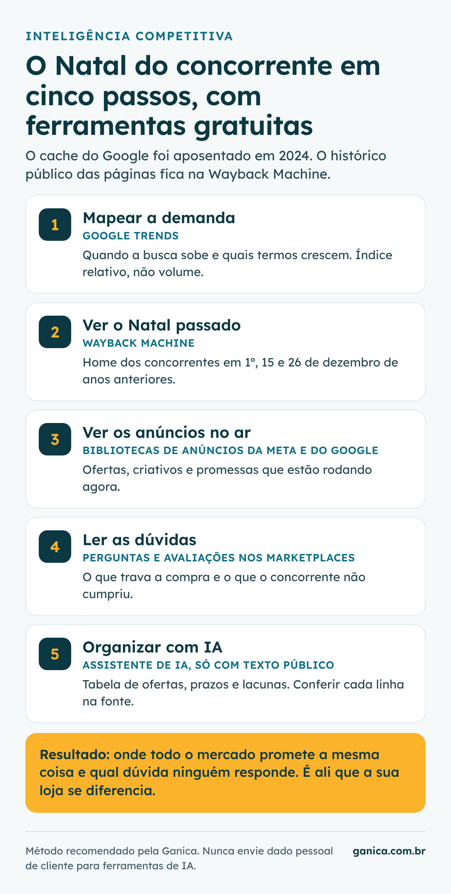
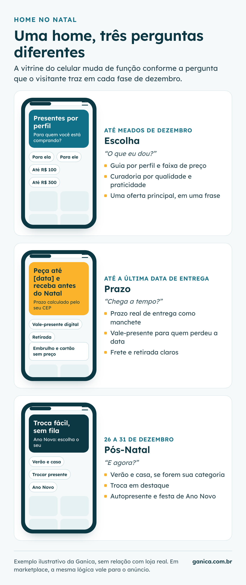

## Quando começa o Natal para quem vende online?

Para vender mais no Natal, o lojista online precisa começar na Black Friday, e não em dezembro. Segundo o [Google com a Offerwise](https://business.google.com/br/think/consumer-insights/insights-natal-2025/), em pesquisa com 2.000 brasileiros das classes A, B e C, 5 em cada 10 compradores de presentes pretendiam começar na temporada da Black Friday: 31% no esquenta e 17% no próprio dia. Segundo o mesmo material, cerca de 19% dos consumidores pretendiam comprar presentes na primeira quinzena de dezembro.

Isso muda a pergunta que a loja precisa fazer. Não é "quando começar a campanha de Natal", e sim "como transformar o cliente da Black Friday no cliente do Natal". Quem compra na Black para presentear já está na jornada de Natal, e quem só olhou ofertas pode voltar. A [Black Friday 2026](/quando-comeca-black-friday-brasil-ecommerce.html) cai em 27 de novembro, e é ali que a temporada de presentes ganha tração.

A internet é parte central dessa jornada. Na pesquisa de Intenção de Compras para o Natal 2025, da [CNDL e do SPC Brasil](https://mercadoeconsumo.com.br/27/11/2025/noticias-varejo/vendas-no-natal-devem-movimentar-r-85-bi-na-economia-brasileira-mostra-pesquisa/), 58% dos consumidores disseram que comprariam ao menos um presente pela internet, e 82% de quem ia comprar pretendia pesquisar preços antes.

## Por que dezembro tem duas temporadas, e não um pico?

Dezembro tem duas temporadas porque o pós-Natal vende quase tanto por dia quanto a semana do Natal. Em dados da Confi Neotrust [divulgados pelo Money Times](https://www.moneytimes.com.br/vendas-do-varejo-online-no-natal-e-ano-novo-sobem-mas-valor-medio-recua-diz-pesquisa-fets/), o e-commerce faturou R$ 5,9 bilhões de 19 a 25 de dezembro de 2025, alta de 14,2%, e R$ 4,8 bilhões de 26 a 31 de dezembro, alta de 24,8%. Na semana do Natal, o ticket médio caiu 7,9%; no pós-Natal, foi de R$ 305, alta de 3,4% sobre 2024.

| Fase de dezembro de 2025 (Confi Neotrust) | Faturamento diário médio |
|---|---|
| Primeira quinzena (R$ 19,88 bi em 15 dias) | cerca de R$ 1,3 bi |
| Semana do Natal, 19 a 25 (R$ 5,9 bi em 7 dias) | cerca de R$ 0,84 bi |
| Pós-Natal, 26 a 31 (R$ 4,8 bi em 6 dias) | cerca de R$ 0,80 bi |

*Confi Neotrust, via Mercado&Consumo e Money Times. Médias calculadas pela Ganica; a primeira quinzena foi tratada como 15 dias, e os dias 16 a 18 não têm recorte divulgado. Use como ordem de grandeza.*

Na leitura da Ganica, a tabela desmonta duas crenças. A primeira é que a semana do Natal é o auge: na [primeira quinzena de dezembro](https://mercadoeconsumo.com.br/23/12/2025/ecommerce/e-commerce-cresce-15-e-fatura-r-199-bilhoes-na-primeira-quinzena-do-natal-2025/), a média diária foi maior, provavelmente porque quem compra online precisa receber a tempo. A segunda é que depois do dia 25 o ano acabou: pela conta da Ganica, o pós-Natal respondeu por cerca de 44% do período de 19 a 31 e, por dia, vendeu cerca de 95% da semana do Natal.

O pós-Natal, porém, não é igual para todas as lojas. Segundo a mesma divulgação da Confi Neotrust, o ar-condicionado somou R$ 433 milhões de 26 a 31 de dezembro, alta de 284%, e, na mesma divulgação, os refrigeradores cresceram 38,5%. Parte relevante do crescimento veio de verão e casa, e não necessariamente de trocas ou autopresente. Quem vende essas categorias tem uma temporada comprovada; quem vende presentes tem uma hipótese a testar.

 e do Google com a Offerwise.")

## O que os concorrentes fizeram no Natal passado, e como descobrir?

Descobrir o que os concorrentes fizeram no Natal passado é possível com ferramentas gratuitas. O antigo atalho, o cache do Google, não existe mais: segundo a [Search Engine Land](https://searchengineland.com/google-search-officially-retires-cache-link-437122), o Google retirou o link de cache no início de 2024, e Danny Sullivan, do Google, disse esperar, sem promessa, apontar para o Internet Archive no lugar. É o Internet Archive que mantém a [Wayback Machine](https://web.archive.org/), com capturas de páginas públicas ao longo do tempo.

A recomendação da Ganica é um método em cinco passos:

1. **Mapeie a demanda no Google Trends.** No [Explore](https://trends.google.com/trends/explore?date=today+5-y&geo=BR&q=presente+de+natal&hl=pt-BR), compare cinco anos de termos como "presente de natal" e os da sua categoria. O Trends mostra interesse relativo, não volume: o valor está em ver quando a curva sobe e quais consultas relacionadas crescem.
2. **Abra a home dos concorrentes em dezembro passado.** Na Wayback Machine, digite o endereço do concorrente e escolha capturas de 1º, 15 e 26 de dezembro de 2024 e 2025. Anote a oferta principal, o prazo de entrega prometido e quando a vitrine mudou.
3. **Veja os anúncios que estão no ar.** A [Biblioteca de Anúncios da Meta](https://www.facebook.com/ads/library/) mostra anúncios ativos no Facebook, no Instagram e em outras plataformas da empresa. A [Central de Transparência de Anúncios do Google](https://adstransparency.google.com/) mostra anúncios de anunciantes verificados na busca, no YouTube e na rede de display.
4. **Leia as perguntas e avaliações nos marketplaces.** Nos anúncios mais vendidos da sua categoria, as perguntas revelam as dúvidas que travam a compra, e as avaliações negativas mostram promessas que o concorrente não cumpriu.
5. **Peça a uma IA que organize, não que conclua.** Cole o texto público coletado e peça uma tabela de ofertas, promessas de entrega, objeções e lacunas por concorrente. Confira cada linha na fonte, porque assistentes de IA erram com segurança, e nunca cole dado pessoal de cliente.

## Como deve ser a home para vender mais no Natal?

Na leitura da Ganica, a home para vender mais no Natal precisa mudar de função três vezes, acompanhando a pergunta que o visitante traz em cada fase. Até meados de dezembro, a pergunta é "o que dar"; na reta final, "chega a tempo"; depois do dia 25, "o que faço agora".

- **Fase da escolha, até meados de dezembro.** Guia de presentes por perfil de quem recebe e por faixa de preço. Segundo o Google com a Offerwise, qualidade e durabilidade (28%) e praticidade (16%) lideram os critérios de escolha do presente; a curadoria precisa falar disso, e não só de desconto. É a mesma lógica dos kits por objetivo, um padrão que encontramos com frequência em diagnósticos: agrupar pela necessidade de quem compra comunica melhor que listar produtos soltos.
- **Fase do prazo, até a última data de entrega.** O prazo vira a manchete, com vale-presente digital como saída para quem perdeu a data. Segundo dados internos do Google citados no [Think with Google](https://business.google.com/br/think/consumer-insights/insights-natal-2025/), informação clara de frete, entrega e retirada esteve associada a aumentos de 10% no CTR e de 13% na conversão no Google Shopping, com resultados que variam por anunciante.
- **Fase do pós-Natal, de 26 a 31 de dezembro.** Verão e casa em destaque, se forem categorias da loja, além de trocas fáceis, presente para si mesmo e produtos para a festa de Ano Novo.

A data-limite da fase do prazo é o maior risco de dezembro, e vale calcular com método:

1. **Meça o seu prazo real de separação** em dias de pico, não em dias normais.
2. **Some o prazo da transportadora por região**, com base nos seus envios de dezembro passado.
3. **Acrescente uma margem de segurança** e conte de trás para frente a partir do dia 24.
4. **Publique a data por região** na home, no carrinho e no anúncio; vencida a data, troque a promessa pelo vale-presente digital.

## Quais gatilhos mentais funcionam no Natal sem queimar a marca?

Na leitura da Ganica, os gatilhos que funcionam no Natal são os que descrevem algo verdadeiro: prazo, estoque, avaliação real e ajuda na escolha. Gatilho mental é um atalho de decisão, como escassez ou prova social, que acelera a compra quando reduz a dúvida. Inventado, vira risco jurídico e de reputação.

| Gatilho | Versão honesta no Natal |
|---|---|
| Urgência | Data-limite real de entrega antes do dia 25 |
| Escassez | Estoque real exibido, sem contador que reinicia |
| Prova social | Avaliações de compradores e "mais presenteados" medidos |
| Reciprocidade | Guia de presentes útil, embalagem e cartão sem custo |
| Compromisso | Lista de desejos e lembrete de preço salvo |

*Leitura da Ganica.*

O limite também é legal. Pelo [Código de Defesa do Consumidor](https://www.planalto.gov.br/ccivil_03/leis/l8078compilado.htm), urgência e escassez inventadas, e preço inflado para simular desconto, podem configurar publicidade enganosa (art. 37). Há ainda um erro comum e menos visível que um contador falso: o excesso de benefícios.

> Vários benefícios ao mesmo tempo confundem o cliente e consomem a margem.

É um padrão que encontramos com frequência em diagnósticos: lojas que acumulam desconto de primeira compra, frete grátis por faixa, brindes e promoções gerais. O cliente não entende qual vale e a margem some sem ganho claro de conversão. A regra prática é uma oferta principal por fase, dita em uma frase.

## Como capturar e-mails antes do Natal?

Segundo o Google com a Offerwise, 31% dos compradores de presentes pretendiam começar no esquenta da Black Friday; é nesse tráfego que a loja precisa capturar o contato, oferecendo utilidade em vez de mais desconto. O visitante que chega pela oferta da Black e não compra pode ser quem vai procurar presentes em dezembro.

1. **Troque o cupom por um serviço.** Ofereça o guia de presentes por perfil, o aviso da data-limite de entrega e o lembrete de troca. Isso não ensina o cliente a esperar desconto.
2. **Pergunte para quem é o presente.** Um campo opcional na captura (para quem, faixa de preço) permite enviar sugestões relevantes em vez de um e-mail igual para toda a base.
3. **Peça o consentimento do jeito certo.** A [LGPD](https://www.planalto.gov.br/ccivil_03/_ato2015-2018/2018/lei/l13709.htm) exige base legal para tratar dado pessoal; para envio de marketing, a prática segura é o consentimento claro, separado da compra, com descadastro fácil.
4. **Desenhe a sequência antes de captar.** Black Friday, guia de presentes, data-limite de entrega, confirmação e pós-compra, Ano Novo.

No marketplace, o contato do comprador pertence ao canal. As regras de comunicação variam por plataforma, então confira as do seu canal antes de qualquer ação, e use bem o que ele oferece: perguntas, mensagens pós-venda permitidas e seguidores da loja.

## Como fazer um pós-venda de qualidade no Natal e no Ano Novo?

Na leitura da Ganica, pós-venda de qualidade no Natal começa antes da entrega e termina em janeiro, com a troca resolvida e o presenteado transformado em cliente. Presente tem duas pessoas: quem pagou e quem recebe. A troca é a primeira impressão que quem recebe tem da marca.

- **Antes da entrega:** opção de presente com embalagem, mensagem e cartão sem preço; rastreio proativo, porque atraso no Natal custa a confiança de duas pessoas.
- **Na troca:** segundo o [Idec](https://idec.org.br/idec-na-imprensa/comprou-presentes-pela-internet-veja-quais-sao-regras-para-troca), a loja não é obrigada a trocar por gosto, cor ou tamanho quando não há defeito, mas precisa cumprir a política que anunciou. O direito de arrependimento da compra online (art. 49 do CDC) é de quem comprou e conta 7 dias a partir do recebimento, então um presente comprado na Black Friday costuma passar desse prazo antes do Natal. Na prática, a troca de Natal depende da política da loja, e uma política estendida, explicada na página do produto, é decisão de negócio que tende a reduzir a dúvida de quem compra para outra pessoa.
- **Em janeiro:** pedido de avaliação depois da troca resolvida, e uma primeira oferta para o presenteado comprar para si. É aqui que o Natal deixa de ser campanha e vira [receita por cliente](/crescimento-ecommerce-brasil-receita-por-cliente.html).

Para medir, separe no GA4 e na plataforma os mesmos três recortes da tabela (primeira quinzena, semana do Natal, 26 a 31) e compare com o ano anterior, por categoria. A pergunta é em qual fase a sua loja perdeu receita, e um [diagnóstico de CRO](/#diagnostico) responde isso com os seus dados.

## O que ainda não sabemos

Os dados de faturamento são de mercado, divulgados pela imprensa, e a Confi Neotrust não detalha o método nessas divulgações. Os recortes de dezembro saíram em momentos diferentes, e as médias diárias servem como ordem de grandeza, não como série comparável. A pesquisa do Google com a Offerwise mede intenção, cobre só as classes A, B e C, e a da CNDL não teve amostra informada na divulgação.

Também não há dado público que meça o efeito isolado de cada prática deste guia, como guia de presentes, política de troca estendida ou captura com consentimento, nem que mostre quanto do pós-Natal vem de trocas. Por isso, cada uma deve entrar como hipótese a medir na própria loja, comparando as três fases de dezembro com o ano anterior.
