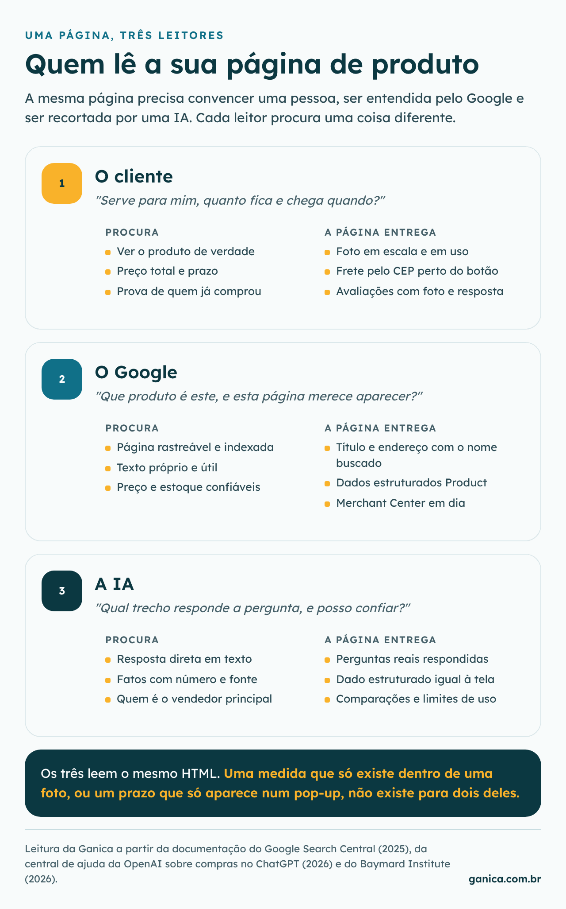
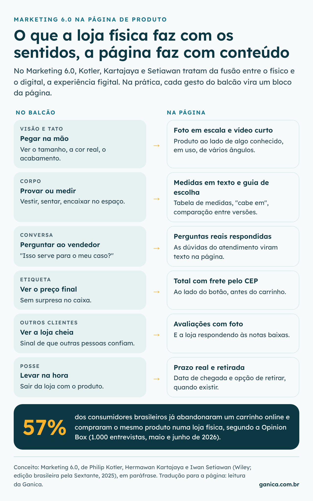
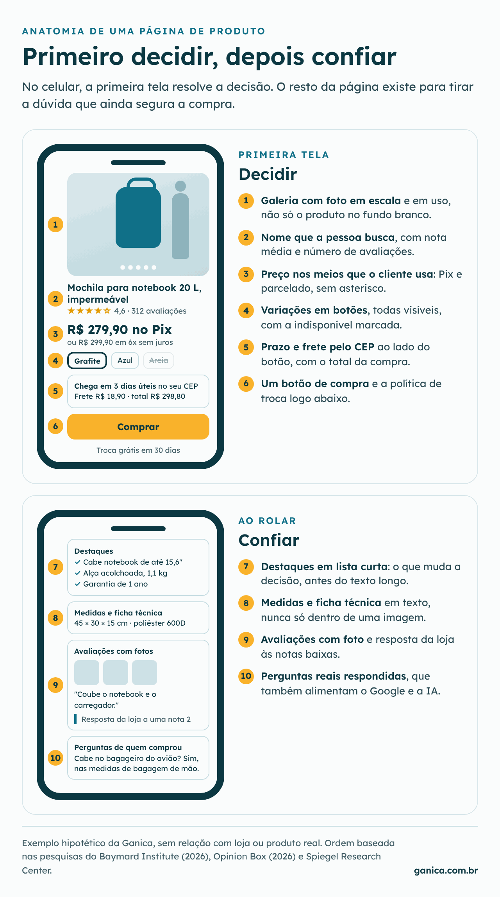
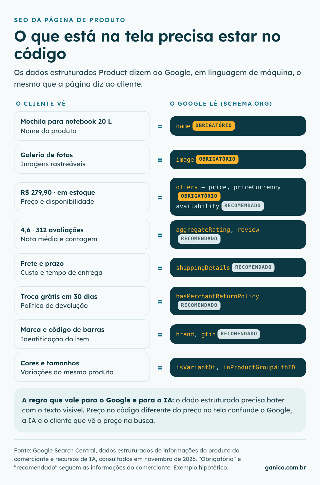

## Qual é a estrutura ideal de uma página de produto?

Imagine uma pessoa que precisa de uma mochila para levar o notebook ao trabalho. Ela pergunta ao ChatGPT qual comprar, abre dois resultados do Google e, pelo celular, entra na página de produto de uma loja. Em poucos segundos ela quer saber três coisas: se a mochila serve para ela, quanto vai pagar no total e quando vai chegar. Se a primeira tela da página responde essas três perguntas, e o restante prova as respostas com medidas, avaliações e dúvidas já respondidas, a página está bem estruturada. Se não responde, a pessoa sai, e quase sempre sem avisar o motivo.

Essa cena tem três leitores, e é por isso que este estudo segue a ordem dela de trás para frente. Primeiro vem o cliente, que decide se compra quando chega à página. Depois vem o Google, que decide se a página aparece para ele. Por fim vem a IA, que hoje muitas vezes faz a primeira recomendação antes mesmo do clique. Os três leem o mesmo conteúdo, mas cada um procura uma coisa diferente.

O primeiro leitor é justamente onde o mercado mais erra. No benchmark de 2026 do [Baymard Institute](https://baymard.com/research-articles/current-state-ecommerce-product-page-ux?r=0), que avaliou mais de 155 grandes sites dos Estados Unidos e da Europa, só 38% das páginas de produto no celular foram consideradas razoáveis ou boas, e nenhuma chegou ao nível perfeito. Se lojas desse porte ainda deixam a pessoa sem resposta, vale entender com quem a sua página está sendo comparada quando isso acontece.

## Por que a página de produto concorre com a loja física?

A pessoa da nossa história, quando não encontra a resposta na tela, tem uma alternativa muito concreta: ir até uma loja, pegar a mochila na mão e perguntar ao vendedor se o notebook cabe. Segundo a pesquisa de abandono de carrinho de 2026 da [Opinion Box](https://content.app-us1.com/JY8yY/2026/07/22/9f1cd26c-4f0b-49a1-a684-95615a71c688.pdf), com mil entrevistas no Brasil, 57% dos consumidores já desistiram de um carrinho online e compraram o mesmo produto numa loja física. A página de produto não concorre só com o site do vizinho; concorre com o balcão.

Essa é a ideia central do [Marketing 6.0](https://www.wileyindia.com/marketing-6-0-the-future-is-immersive.html), de Philip Kotler, Hermawan Kartajaya e Iwan Setiawan, publicado no Brasil pela Sextante em 2025. Os autores defendem que o físico e o digital estão se fundindo numa experiência só, que chamam de figital, puxada pelas gerações que cresceram sem separar os dois mundos. Segundo a [resenha do Journal of General Management](https://researchonline.jcu.edu.au/84356/8/JCU_84356%20AAM.pdf), o livro dá destaque a experiências que envolvem os cinco sentidos e a uma conversa mais natural entre pessoa e máquina, por voz e câmera. Trazido para o e-commerce, isso significa que cada coisa que o cliente resolve com as mãos e com a conversa na loja precisa ter um equivalente na página.

O livro, porém, aposta bastante em metaverso e óculos de realidade virtual, e aí o Brasil pede um ajuste. Segundo a [TIC Domicílios 2025](https://www.cetic.br/media/docs/publicacoes/2/pt-br/20260511173151/tic_domicilios_2025_resumoexecutivo%20pt.pdf), 65% dos usuários de internet no país acessam a rede apenas pelo celular. Para a maioria das lojas brasileiras, a experiência imersiva possível hoje é bem mais simples do que a do livro: uma foto que mostre o tamanho real, um vídeo curto do produto em uso e respostas escritas para as dúvidas que o vendedor responderia. É isso que a próxima parte organiza.

## O que o cliente precisa encontrar na página de produto?

Na prática, a página de produto precisa fazer o papel do vendedor em dois momentos. No primeiro, que cabe na tela inicial do celular, a pessoa decide se aquele produto é candidato: ela vê a foto, o nome, a nota dos outros clientes, o preço do jeito que vai pagar, a variação que quer, o frete com prazo e o botão. No segundo, quando rola a página, ela procura motivos para confiar na decisão: medidas, materiais, avaliações com foto e respostas para casos parecidos com o dela.

A primeira dúvida que trava a compra costuma ser o tamanho, e ela se resolve na foto. Segundo o Baymard, 42% dos usuários tentam entender o tamanho do produto olhando as imagens, mas 37% dos sites não têm nenhuma foto em escala, aquela em que o produto aparece ao lado de uma pessoa ou de um objeto conhecido. No exemplo da mochila, uma foto dela nas costas de alguém e outra aberta com um notebook dentro respondem em um segundo o que a ficha técnica leva um parágrafo para explicar.

A segunda dúvida é o custo total, e no Brasil ela pesa mais do que qualquer outra. Na mesma pesquisa da Opinion Box, 57% de quem abandona um carrinho aponta o frete acima do esperado como motivo, 32% citam taxas inesperadas e 26% reclamam de prazo maior do que imaginavam. Mesmo assim, 67% dos sites avaliados pelo Baymard não mostram uma estimativa do custo total perto do botão de compra. Colocar o cálculo de frete e prazo pelo CEP logo ao lado do botão, junto com o preço no Pix, que respondeu por 42% do valor do e-commerce brasileiro em 2025 segundo o [Global Payments Report 2026](https://www.portaltela.com/economia/2026/05/25/pix-atinge-42-dos-pagamentos-online-no-brasil/), evita que a surpresa apareça só no carrinho.

A terceira dúvida é o que acontece se der errado. Segundo o Baymard, 60% dos usuários procuram a política de troca e devolução na própria página do produto, e 44% dos sites não a mostram ali. Uma linha curta abaixo do botão, dizendo em quantos dias e como a troca funciona, costuma bastar para quem está em dúvida entre dois tamanhos.

Por fim, vem a confiança, que nenhum texto da marca substitui. No estudo do [Spiegel Research Center](https://spiegel.medill.northwestern.edu/How-Online-Reviews-Influence-Sales), da Northwestern University, um produto com cinco avaliações teve chance de compra 270% maior do que um produto sem nenhuma, e o efeito foi ainda maior nos itens mais caros. O mesmo estudo mostra que notas entre 4,0 e 4,7 tendem a vender mais do que a nota perfeita, que parece boa demais para ser verdade. Por isso vale mostrar as avaliações negativas e responder a elas, algo que 89% dos sites do Baymard não fazem.

| Bloco da página | Dúvida que ele responde |
|---|---|
| Foto em escala e em uso | De que tamanho é, de verdade? |
| Preço no Pix e parcelado | Quanto pago do jeito que pago? |
| Frete e prazo pelo CEP | Quanto fica e quando chega? |
| Troca perto do botão | E se não servir? |
| Medidas em texto | Cabe, funciona, dura? |
| Avaliações com foto | Quem comprou aprovou? |
| Perguntas respondidas | E no meu caso? |

*Leitura da Ganica, com base no Baymard Institute (2026), na Opinion Box (2026) e no Spiegel Research Center (2017).*

Uma página assim convence quem chegou até ela. A pergunta seguinte é como fazer mais gente chegar, e a resposta passa por organizar esse mesmo conteúdo de um jeito que o Google consiga ler.

## O que o Google precisa ler na página de produto?

O Google não vê a foto da mochila nas costas de alguém do mesmo jeito que o cliente vê. Ele lê o texto da página e, quando existem, os dados estruturados: um código padronizado (schema.org) que descreve o produto em linguagem de máquina, com nome, imagem, preço, estoque, nota, frete e política de troca. Segundo a [documentação do Google sobre dados estruturados Product](https://developers.google.com/search/docs/advanced/structured-data/product?hl=pt-br), esse código ajuda o produto a aparecer de forma mais completa na busca, com preço, nota e disponibilidade no próprio resultado, e também no Google Imagens e no Google Lens. Para [páginas em que é possível comprar o item](https://developers.google.com/search/docs/appearance/structured-data/merchant-listing?hl=pt-br), o Google pede, no mínimo, nome, imagem, preço e moeda.

O ponto que mais escapa nas lojas que analisamos não é a falta do código, e sim a diferença entre o código e a tela. O preço muda numa promoção, o estoque acaba numa cor, e o dado estruturado continua dizendo outra coisa, porque foi configurado uma vez e esquecido. O cliente então vê na busca um preço que não encontra na página, e a confiança se perde antes da primeira foto.

O restante do SEO da página de produto é menos técnico do que parece e conversa diretamente com o que o cliente precisa. O título da página deve usar o nome que as pessoas digitam, como "mochila para notebook 20 litros impermeável", e não o código interno do produto. A descrição pode aproveitar a ficha técnica do fabricante, mas o texto que responde dúvidas precisa ser próprio, porque é ele que diferencia a sua página das dezenas de lojas que vendem o mesmo item. As medidas que hoje estão escritas dentro de uma imagem precisam existir também como texto, as fotos precisam de descrição e de arquivo leve para abrir rápido no celular, e cada variação vendável precisa de um endereço próprio, que é a regra do Google para páginas de compra.

Para o analista, o Search Console tem dois relatórios que mostram se esse trabalho está funcionando: o de snippets de produto e o de informações do produto do comerciante, que apontam erros na marcação e quantas vezes as páginas apareceram com esses recursos. O Google também recomenda cadastrar os produtos no Merchant Center; segundo a [página do Google sobre dados de produto](https://developers.google.com/search/docs/specialty/ecommerce/share-your-product-data-with-google?hl=pt-br), ele não é obrigatório para a busca comum, mas é necessário para aparecer na aba Shopping.

Tudo isso abre a porta da busca tradicional. Só que, na nossa história, a primeira recomendação veio de uma IA, e é ali que muitas compras passaram a começar.

## O que a IA precisa para citar a sua página de produto?

Quando alguém pergunta ao ChatGPT ou ao Gemini qual mochila comprar, a IA monta a resposta a partir de trechos de páginas que ela considera confiáveis. Fazer o seu conteúdo ser um desses trechos é o que o mercado chama de GEO, a otimização para motores de IA. A boa notícia é que quase tudo o que foi feito para o cliente e para o Google já é o caminho.

O próprio Google diz isso. Na página sobre [recursos de IA](https://developers.google.com/search/docs/appearance/ai-features), ele afirma que não há requisito extra nem otimização especial para aparecer nos Resumos de IA e no Modo IA. Valem os fundamentos de SEO, com três cuidados citados de forma explícita: deixar o conteúdo importante em texto, manter os dados estruturados iguais ao que aparece na tela e manter o Merchant Center atualizado. A OpenAI descreve uma lógica parecida na [central de ajuda sobre compras no ChatGPT](https://help.openai.com/en/articles/11128490): a ferramenta usa dados estruturados de lojas e de terceiros, como preço e descrição, além de avaliações, e, quando várias lojas vendem o mesmo item, considera disponibilidade, preço, qualidade e se a loja é a fabricante ou a vendedora principal.

Esse último critério merece atenção de quem revende marcas, porque é um padrão que encontramos com frequência nos diagnósticos da Ganica. Quando uma loja vende um produto que o próprio fabricante também vende, as duas páginas disputam a mesma busca, e a do fabricante sai na frente por ser a fonte original. A revendedora só ganha espaço quando responde melhor do que ele: explica para quem o produto serve e para quem não serve, compara modelos parecidos, deixa clara a garantia e mostra o prazo real de entrega.

O formato do texto também faz diferença. No estudo [GEO: Generative Engine Optimization](https://arxiv.org/abs/2311.09735), apresentado em 2024, pesquisadores testaram 10 mil perguntas em motores de IA e viram que incluir fontes, citações e números aumentou em mais de 40% a presença do conteúdo nas respostas, enquanto repetir palavra-chave quase não teve efeito. Para uma página de produto, isso se traduz em informação concreta e verificável: a medida exata, o peso, a compatibilidade, o tempo de garantia, a nota média com o número de avaliações e as perguntas reais dos clientes respondidas em texto.

| O que a IA procura | Onde isso fica na página |
|---|---|
| Uma resposta direta | Destaques e perguntas respondidas |
| Um número concreto | Medidas, peso, garantia |
| Um dado confiável | Dados estruturados iguais à tela |
| A opinião de terceiros | Nota média e avaliações |
| O contexto de uso | Para quem serve e para quem não serve |

*Leitura da Ganica, com base no Google Search Central, na OpenAI e em Aggarwal e coautores (2024).*

Visto de ponta a ponta, o trabalho é um só: a mesma informação clara, escrita e verdadeira serve à pessoa, ao Google e à IA. O que falta é um jeito de revisar a sua página com esse olhar.

## Como revisar a sua página de produto?

O melhor ponto de partida é o produto que mais vende, porque qualquer ganho nele aparece rápido no faturamento. A revisão que fazemos nos diagnósticos segue o mesmo caminho da cliente da nossa história, só que ao contrário, e pode ser feita pelo dono da loja ou pelo analista em poucos dias:

1. **Abra a página no celular, como se fosse comprar.** Sem rolar a tela, veja se dá para saber o tamanho real, o preço total com frete e o prazo de entrega. Tudo o que você precisou procurar é uma dúvida que o cliente também tem.
2. **Leia as conversas do atendimento.** As perguntas que mais se repetem no WhatsApp, no chat e no e-mail são exatamente o que a página não respondeu; as cinco mais frequentes merecem virar texto na página.
3. **Olhe os números do GA4.** Compare a taxa de adição ao carrinho dessa página com a média da loja e separe celular de computador. Se houver mapa de calor ou gravação de sessão, veja até onde as pessoas rolam e em que bloco param.
4. **Confira o que o Google lê.** Passe a página no [Teste de pesquisa aprimorada](https://search.google.com/test/rich-results) e veja se preço, estoque e nota no código batem com a tela; depois abra os relatórios de produto no Search Console.
5. **Pergunte para a IA.** Peça ao ChatGPT e ao Gemini a melhor opção do seu produto para um uso específico e observe quem é citado e que informação os concorrentes oferecem que a sua página não oferece.
6. **Mude e meça.** Ajuste um bloco por vez e compare a adição ao carrinho e a conversão no celular nas quatro semanas antes e depois. Com tráfego suficiente, um teste A/B dá uma resposta mais segura.

Fazer essa revisão antes de aumentar a verba de anúncios evita pagar para levar mais pessoas a uma página que ainda deixa dúvida, como mostra o [guia das quatro alavancas de vendas online](/como-aumentar-vendas-online.html). E quando a dúvida é qual bloco está segurando a venda na sua loja, com os seus próprios dados, esse é o trabalho de um [diagnóstico de CRO](/#diagnostico).

## O que ainda não sabemos

Os números do Baymard vêm de grandes sites dos Estados Unidos e da Europa, avaliados por especialistas com base em testes com usuários. Eles mostram com segurança onde as páginas costumam falhar, mas não dizem quanto cada correção rende em vendas numa loja brasileira; essa resposta só aparece medindo a sua própria loja.

O estudo do Spiegel é de 2017 e foi feito com lojas americanas. É razoável esperar que o peso das avaliações continue alto, mas o tamanho do efeito pode ser outro hoje e no Brasil. A pesquisa de GEO, por sua vez, testou perguntas de vários tipos, não apenas de compra, e os motores de IA mudam de comportamento com frequência, então o que vale hoje precisa ser conferido de tempos em tempos.

Do Marketing 6.0, usamos as ideias como ponto de vista, em paráfrase, a partir do sumário da editora e de resenhas acadêmicas. O livro ajuda a enxergar a página como substituta da experiência da loja, mas não prova nada sobre ela. A ordem proposta aqui é um ponto de partida sólido para testar, não uma regra que dispensa os dados de cada loja.
